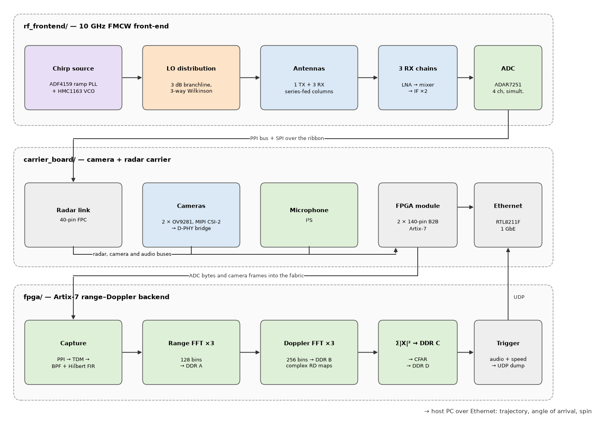

# 10 GHz FMCW Radar Sensing Platform

A single-board **1TX / 3RX, 10 GHz FMCW radar**, its **Artix-7 range–Doppler–CFAR
backend**, and the **carrier board** that mounts the radar alongside a
pair of global-shutter cameras and an impact microphone.

The target application is a golf launch monitor: recover a ball's speed, launch
direction, spin rate and spin axis from radar and camera data. That
application drives every architectural choice here — three non-collinear
receivers (the minimum that gives a radar-native spin axis), per-receiver
*complex* range–Doppler maps published to DDR3 (the phase the spin-axis
interferometer consumes), and a once-per-shot Ethernet offload so the heavy
post-processing runs on a host PC instead of in fabric.

## Repository structure

| Path | Subsystem |
|---|---|
| [`rf_frontend/`](rf_frontend/) | The 10 GHz 1TX/3RX FMCW front-end: KiCad schematics and PCB on Isola 370HR |
| [`fpga/`](fpga/) | Artix-7 gateware: the raw-ADC → range–Doppler → CFAR pipeline, the DDR-to-host UDP offload path, MicroBlaze firmware, and the simulation stack |
| [`carrier_board/`](carrier_board/) | The carrier PCB that ties two cameras, radar, the FPGA module, Ethernet and audio together |

Each subsystem has its own README with the detail; the tables below are the map.

### `rf_frontend/` — 10 GHz FMCW front-end

A closed-loop fractional-N ramp PLL (ADF4159) drives a 10 GHz VCO (HMC1163)
across a 192 MHz sweep in 108 µs. A branchline coupler and a 3-way Wilkinson
tree supply a coherent LO to three
LNA-first receive chains (PMA3-14LN+ → LTC5548 → ADA4940-2), which land on an
ADAR7251's simultaneously-sampled channels. The antennas are series-fed patch
columns arranged in a staggered "^", stepped λ/2 between adjacent phase centres
in both array axes, so per-Doppler-bin angles never wrap.

→ [`rf_frontend/README.md`](rf_frontend/README.md)

### `fpga/` — Artix-7 digital backend

`01_adar7251_ppi_rx` → TDM mux → band-pass + Hilbert FIR → per-RX range FFT →
transposed DDR scatter (region A) → Doppler sequencer → per-RX Doppler FFT →
non-coherent integration (region C) + per-RX complex cache (region B) →
streaming cell-averaging CFAR (region D). A 128 × 256 grid, double-buffered so
software never reads a torn frame. An audio-plus-speed trigger picks the first
frame after impact that clears both gates and dumps its B/C/D regions to the
host over UDP.

→ [`fpga/README.md`](fpga/README.md)

### `carrier_board/` — camera + radar carrier

The routed six-layer carrier connects two OV9281 cameras through MC20901
bridges, the radar through a 40-pin FPC, and the Artix-7 module through two
140-pin B2B connectors. It also carries I²S audio, Gigabit Ethernet, and the
power tree.

→ [`carrier_board/README.md`](carrier_board/README.md)

## Status

| Item | State |
|---|---|
| `rf_frontend/` schematics + PCB layout | Routed KiCad project; board validation remains open |
| `fpga/` RTL pipeline (`01`…`08`) | Complete; unit tests and a raw-ADC-to-CFAR xsim run against the real Xilinx FFT/FIR IP |
| `fpga/` host offload (streamer, packetizer, receiver) | Complete and unit-tested |
| `fpga/firmware/audio_dsp.c` | Complete |
| `fpga/firmware/fusion_control.c` | **Work in progress** — the audio + speed trigger FSM and its frame-selection policy are still being written |
| `carrier_board/ov9281/` | Routed KiCad project; camera fit and board bring-up remain open |

## Toolchain

| Tool | Used for |
|---|---|
| KiCad 10 | `rf_frontend/kicad/`, `carrier_board/ov9281/` |
| Vivado 2025.1 | Block design, IP generation, synthesis, the xsim end-to-end run |
| Icarus Verilog | The RTL unit tests — they need no vendor IP (`fpga/sim/run_unit_tests.sh`) |
| Python 3 (numpy, matplotlib) | Stimulus generation, CFAR golden checks, the UDP frame receiver |
| FreeCAD | Archived IMX477 lens holder in `carrier_board/archive/imx477/mechanical/` |

Large generated trees are deliberately out of the repository: the Vivado
project's `.runs`/`.gen`/`.cache` output, xsim build directories, and the ADS
and HFSS workspaces.
