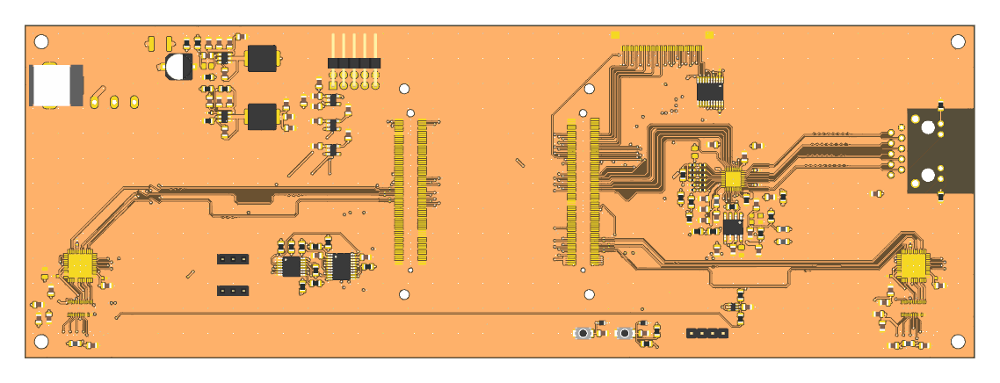

# `carrier_board/` — camera + radar carrier

The carrier connects two OV9281 global-shutter cameras, the radar front-end,
and an I²S impact microphone to an Embedfire Artix-7 module. Captured data can
be buffered and offloaded to the host over Gigabit Ethernet.



## `ov9281/` — OV9281 carrier

| Sheet or file | Interface |
|---|---|
| `extension.kicad_sch` (CAM) | Two OV9281 modules, 200 mm apart. Each MC20901 bridge converts two-lane MIPI D-PHY high-speed signals to LVDS and carries low-power signals separately. |
| `FPGA.kicad_sch` | Two 140-pin board-to-board connectors to the Artix-7 module, JTAG, and the I²S microphone interface. |
| `FMCW.kicad_sch` | 40-pin shielded FPC to the radar front-end. |
| `ETH.kicad_sch` | RTL8211F-CG Gigabit Ethernet PHY and HY911130A RJ45 with integrated magnetics. |
| `power.kicad_sch` | 12 V barrel input, TPS54302 bucks, and TLV755 LDOs. |
| `v2.kicad_pcb` | Routed 228 × 80 mm, six-layer carrier. |
| [`fpga_pins.xdc`](ov9281/fpga_pins.xdc) and [`fpga_pinmap.csv`](ov9281/fpga_pinmap.csv) | Carrier-to-module pin assignments for the XC7A100T/200T. |

The camera receptacles use placeholder footprints pending mating-fit verification.
Assembly and bring-up remain open.

## Opening the board

```sh
kicad carrier_board/ov9281/v2.kicad_pro   # KiCad 10
```

The IMX477 main board, sensor board, render and lens holder are in
[`archive/imx477/`](archive/imx477/).
