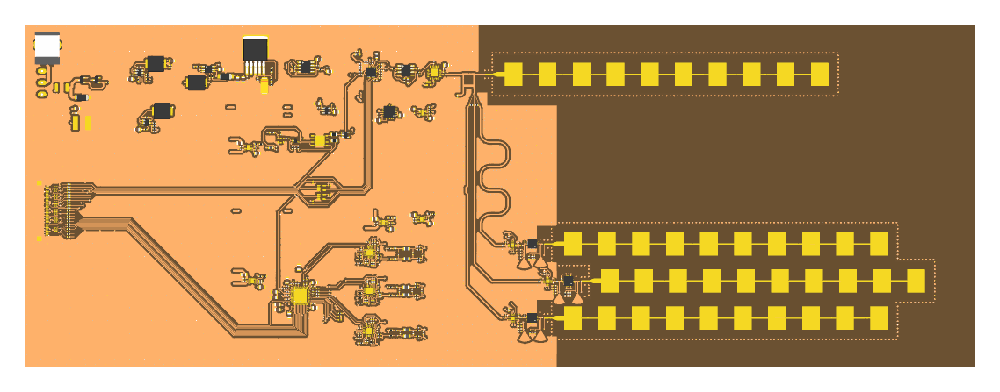
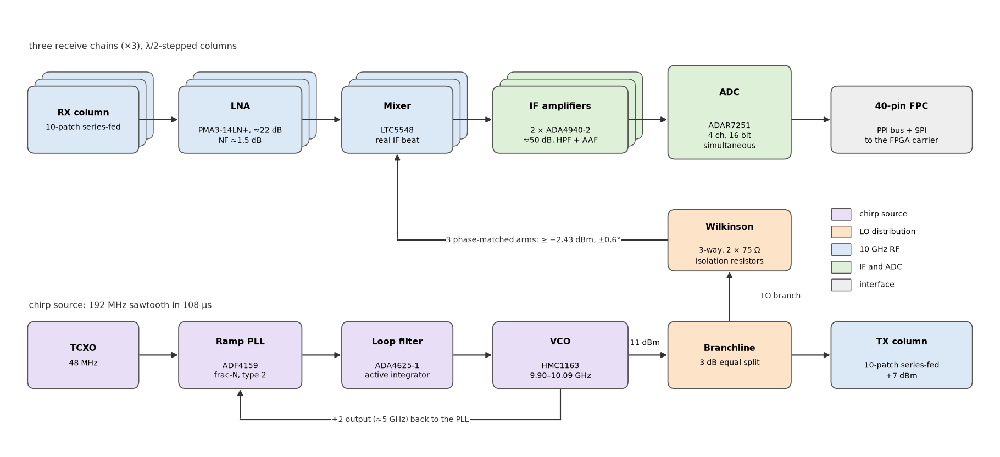

# `rf_frontend/` — 10 GHz 1TX/3RX FMCW front-end



The analog half of the platform: a coherent FMCW radar that sweeps 192 MHz
around 10 GHz in 108 µs, radiates it from a series-fed patch column, and lands
three receive chains on an ADAR7251's simultaneously-sampled ADC channels.
Simultaneous sampling is the point — it is what preserves the inter-receiver
phase that angle-of-arrival and the spin-axis interferometer downstream consume.

Everything is discrete MMIC rather than an integrated transceiver, so each
channel's gain, noise figure and LO drive is set and measurable on its own.

## Signal chain



## Key components

| Function | Part |
|---|---|
| Ramp PLL (fractional-N, type 2) | ADF4159 |
| VCO, 10 GHz fundamental + ÷2 | HMC1163 |
| Loop-filter amplifier (JFET input) | ADA4625-1 |
| Reference oscillator / buffer | KT2520K, NB3N551 |
| LNA, ×3 | PMA3-14LN+ |
| Downconversion mixer, ×3 | LTC5548 |
| Differential IF driver | ADA4940-2 |
| ADC — 4 channels, simultaneous sampling | ADAR7251 |
| LO distribution | LO-favor branchline coupler + 3-way Wilkinson with two 75 Ω isolation resistors + phase-trimmed arms (all distributed, on-board) |
| Pad attenuators | PAT1220 (4 dB / 6 dB) |
| Supplies | TPS7A4701 and TPS7A91 (low-noise LDO for the RF rails), TPS54302, MIC29302A, ADP1613 boost |
| Host interface | 40-pin shielded FPC to the carrier board |

## Antenna array

Three receive columns and one transmit column use series-fed patches on the
top layer. Ground cutouts and stitched feed transitions connect the columns
to the RF front-end.

## Substrate

Four-layer Isola 370HR, with the RF routing referenced to In1 and the antenna
columns over In2.

## Layout

| Path | Contents |
|---|---|
| `kicad/V3.kicad_pro`, `V3.kicad_sch` | KiCad project and top-level sheet |
| `kicad/TX.kicad_sch` | VCO, ramp PLL, loop filter, coupler, LO tree, TX feed |
| `kicad/RX.kicad_sch` | 3× LNA → mixer receive chains |
| `kicad/IF.kicad_sch` | IF conditioning and the ADAR7251 |
| `kicad/power.kicad_sch` | Power tree, with the RF rails on low-noise LDOs |
| `kicad/V3.kicad_pcb`, `V3.kicad_dru` | Board layout and custom DRC rules (net classes, input-path width) |
| `kicad/Design1.pll`, `Design2.pll` | ADIsimPLL loop designs |
| `kicad/footprints/` | Project-local libraries — including the hand-drawn `antenna`, `splitter` and `branchline` distributed structures |
| `figures/` | Link budget and board render |

The distributed structures are *footprints*, not components: the patch column,
the Wilkinson splitter and the branchline coupler are drawn as copper in
`kicad/footprints/*.pretty` and placed like parts.

## Status

The routed KiCad design is included. Board validation remains open.

## Opening the board

```
kicad rf_frontend/kicad/V3.kicad_pro     # KiCad 10
```

The render at the top of this page was produced with `kicad-cli pcb render`.
